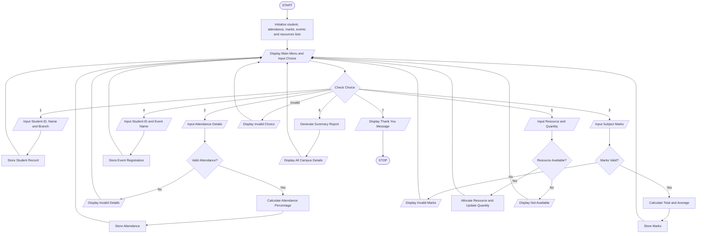

# Comprehensive Smart Campus Management Simulation

Case Study: Python Programming – Activity-Based Learning (ABL)

## 1. Problem Statement

Develop a menu-driven Python program to simulate a Smart Campus Management System. The system should manage student records, attendance, marks, event registration, and classroom resource allocation. It should allow users to select different operations through a menu, store and process data using lists, nested lists, strings, tuples, and tuple unpacking. The program should use conditional statements and loops to perform operations and generate a summary report displaying student details, attendance percentage, marks, event registrations, and resource availability.

## 2. Algorithm

1. Start the program.
2. Initialize empty lists to store student records, attendance, marks, event registrations, and resource details.
3. Display the Smart Campus Management main menu.
4. Ask the user to select an option.
5. If the user selects Student Records, enter and display student details.
6. If the user selects Attendance, record attendance and calculate attendance percentage.
7. If the user selects Marks, enter subject marks and calculate total and average.
8. If the user selects Event Registration, register students for campus events.
9. If the user selects Resource Allocation, allocate available campus resources.
10. If the user selects Summary Report, display all stored information.
11. Use conditional statements to process the selected operation.
12. Repeat the menu using a loop until the user selects Exit.
13. Display an exit message.
14. Stop the program.

## 3. Flowchart


Flowchart explanation:

- Oval: START and STOP
- Parallelogram: INPUT and OUTPUT
- Rectangle: PROCESS
- Diamond: DECISION

## 4. Pseudocode

```
BEGIN

    CREATE empty lists:
        students
        attendance
        marks
        events
        resources

    REPEAT

        DISPLAY "SMART CAMPUS MANAGEMENT SYSTEM"

        DISPLAY "1. Student Records"
        DISPLAY "2. Attendance Management"
        DISPLAY "3. Marks Management"
        DISPLAY "4. Event Registration"
        DISPLAY "5. Resource Allocation"
        DISPLAY "6. Summary Report"
        DISPLAY "7. Exit"

        INPUT choice

        IF choice = 1 THEN
            INPUT student ID, name, branch
            STORE student details in students
            DISPLAY student records

        ELSE IF choice = 2 THEN
            INPUT student ID and attendance details
            STORE attendance
            CALCULATE attendance percentage
            DISPLAY attendance percentage

        ELSE IF choice = 3 THEN
            INPUT student ID and subject marks
            CALCULATE total and average
            STORE marks
            DISPLAY marks

        ELSE IF choice = 4 THEN
            INPUT student ID and event name
            STORE event registration
            DISPLAY registration confirmation

        ELSE IF choice = 5 THEN
            INPUT resource name and quantity
            CHECK resource availability

            IF resource is available THEN
                ALLOCATE resource
                DISPLAY allocation successful
            ELSE
                DISPLAY resource not available
            END IF

        ELSE IF choice = 6 THEN
            DISPLAY student records
            DISPLAY attendance details
            DISPLAY marks
            DISPLAY event registrations
            DISPLAY resource allocation
            DISPLAY summary report

        ELSE IF choice = 7 THEN
            DISPLAY "Thank You"

        ELSE
            DISPLAY "Invalid Choice"
        END IF

    UNTIL choice = 7

END
```
## 6. Sample Output

```
===== SMART CAMPUS MANAGEMENT =====
1. Student Records
2. Attendance Management
3. Marks Management
4. Event Registration
5. Resource Allocation
6. Summary Report
7. Exit

Enter your choice: 1
Enter Student ID: 101
Enter Student Name: Kusuma
Enter Branch: CSE
Student record added successfully!

Enter your choice: 2
Enter Student ID: 101
Enter classes attended: 45
Enter total classes: 50
Attendance: 90.0 %

Enter your choice: 3
Enter Student ID: 101
Enter Python marks: 85
Enter Maths marks: 90
Enter Physics marks: 80
Total Marks: 255
Average: 85.0

Enter your choice: 4
Enter Student ID: 101
Enter Event Name: Tech Fest
Event registration successful!

Enter your choice: 5

Available Resources:
Projector : 5
Computers : 20
Smart Boards : 10

Enter resource name: Projector
Enter required quantity: 2
Resource allocated successfully!

Enter your choice: 6

===== CAMPUS SUMMARY REPORT =====

Student Records:
101 Kusuma CSE

Attendance Details:
101 90.0 %

Marks Details:
101 255 85.0

Event Registrations:
101 Tech Fest

Remaining Resources:
Projector 3
Computers 20
Smart Boards 10

Total Students: 1
Total Attendance Records: 1
Total Event Registrations: 1

Enter your choice: 7
Thank you for using Smart Campus Management System!
```


## 8. Concepts Used

| Python concept         | Application                             |
| ---------------------- | --------------------------------------- |
| Conditional statements | Menu selection and validation           |
| While loop             | Repeating the main menu                 |
| For loop               | Displaying records and resources        |
| Strings                | Student names and event names           |
| Lists                  | Storing student records                 |
| Nested lists           | Attendance and marks                    |
| Tuples                 | Event and resource details              |
| Tuple unpacking        | Extracting student and resource details |
| `append()`             | Adding new records                      |
| `len()`                | Counting records                        |
| `enumerate()`          | Updating resource quantities            |

## 9. Conclusion

The Smart Campus Management System provides a simple and efficient way to manage important campus activities through a menu-driven Python program. It integrates student records, attendance, marks, event registration, and resource allocation. It demonstrates the practical use of Python conditional statements, loops, strings, lists, nested lists, tuples, and tuple unpacking. The system reduces manual work and generates a consolidated campus summary report.
