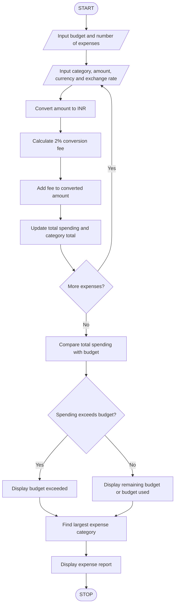

# 3. Multi-Currency Travel Budget Analysis – Python Program

This B.Tech 1st-year assignment includes the problem statement, algorithm, flowchart, Python source code, sample input, sample output, and Mermaid flowchart code.

## 1. Problem Statement

Design a Python program to analyze a travel budget when expenses are recorded in different currencies. The program should convert each expense into the home currency using supplied exchange rates, add currency conversion fees, compare the total travel expenses against the planned budget, and identify the largest expense category.

Example rules used:

- Home currency: Indian Rupee (INR).
- Exchange rates are supplied by the user.
- Currency conversion fee: 2% of the converted amount.
- Budget status: compare total expenses, including conversion fees, against the planned budget.
- Largest expense category: the category with the highest total cost in INR, including fees.

These exchange rates and fees are sample values for the assignment, not live market rates.

## 2. Algorithm

1. Start.
2. Input the travel budget in INR and the number of expenses.
3. For each expense, input the category, original amount, currency code, and exchange rate to INR.
4. Convert the expense into INR by multiplying the original amount by the exchange rate.
5. Calculate the conversion fee as 2% of the converted amount.
6. Add the fee to the converted amount to get the final expense.
7. Add the final expense to the total spending and the relevant expense category.
8. Repeat until all expenses are entered.
9. Compare total spending with the planned budget and display whether the budget is within or exceeded.
10. Identify the category with the highest total expense.
11. Display the expense details and summary.
12. Stop.

## 3. Flowchart



## 5. Sample Input

```
Enter travel budget in INR: 40000
Enter number of expenses: 4

Expense 1
Enter expense category: Hotel
Enter amount: 200
Enter currency code: USD
Enter exchange rate to INR: 83

Expense 2
Enter expense category: Food
Enter amount: 50
Enter currency code: EUR
Enter exchange rate to INR: 90

Expense 3
Enter expense category: Transport
Enter amount: 40
Enter currency code: GBP
Enter exchange rate to INR: 105

Expense 4
Enter expense category: Shopping
Enter amount: 100
Enter currency code: USD
Enter exchange rate to INR: 83
```

## 6. Sample Output

```
--- TRAVEL EXPENSE REPORT ---

Category: Hotel
Original amount: 200.0 USD
Converted amount: Rs. 16600.0
Conversion fee: Rs. 332.0
Final expense: Rs. 16932.0

Category: Food
Original amount: 50.0 EUR
Converted amount: Rs. 4500.0
Conversion fee: Rs. 90.0
Final expense: Rs. 4590.0

Category: Transport
Original amount: 40.0 GBP
Converted amount: Rs. 4200.0
Conversion fee: Rs. 84.0
Final expense: Rs. 4284.0

Category: Shopping
Original amount: 100.0 USD
Converted amount: Rs. 8300.0
Conversion fee: Rs. 166.0
Final expense: Rs. 8466.0

Total spending: Rs. 34272.0
Planned budget: Rs. 40000.0
Budget remaining: Rs. 5728.0

--- CATEGORY SUMMARY ---
Hotel : Rs. 16932.0
Food : Rs. 4590.0
Transport : Rs. 4284.0
Shopping : Rs. 8466.0
Largest expense category: Hotel
Amount: Rs. 16932.0

Travel budget analysis completed.
```

Explanation: Total spending is ₹34,272, including conversion fees. The remaining budget is ₹5,728, and Hotel is the largest expense category.


Note: The program uses exchange rates entered by the user and applies a 2% fee to each converted expense. For this assignment, all category totals include conversion fees, so the largest category reflects the actual total cost of each category.
