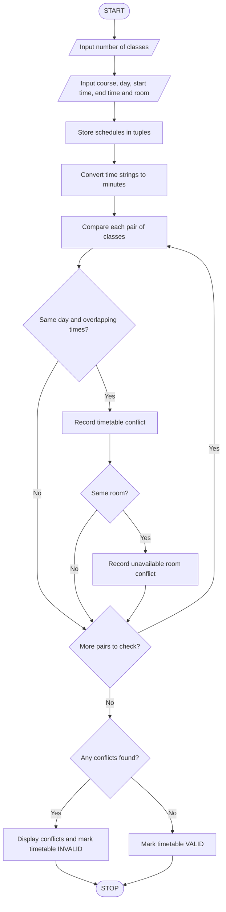

# 4. Student Timetable Conflict Detection – Python Program

This B.Tech 1st-year assignment includes the problem statement, algorithm, flowchart, Python source code, sample input, sample output, and normal Mermaid flowchart code without colors.

## 1. Problem Statement

Design a Python program to validate a student's proposed timetable by comparing course schedules represented using strings and tuples. The program should detect overlapping class periods, identify rooms that are unavailable or already occupied during a proposed class, and determine whether the timetable is valid.

Rules used in this program:

- Each class has a course name, day, start time, end time, and room.
- Two classes conflict if they occur on the same day and their time periods overlap.
- A room is unavailable if another class is scheduled in that room at an overlapping time.
- A timetable is valid only if there are no time conflicts for the student and no room conflicts.

Example: If Mathematics runs from 9:00 to 10:00 AM and Python runs from 9:30 to 10:30 AM on the same day, a conflict exists.

## 2. Algorithm

1. Start.
2. Input the number of classes.
3. For each class, enter the course name, day, start time, end time, and room number.
4. Store the schedule using strings and tuples.
5. Compare each pair of classes scheduled on the same day.
6. Check whether their time periods overlap.
7. If the periods overlap, report a timetable conflict.
8. Check whether the same room is assigned to overlapping classes.
9. Display all conflicts and identify unavailable rooms.
10. If no conflicts are found, declare the proposed timetable valid; otherwise, declare it invalid.
11. Stop.

## 3. Flowchart


## 5. Sample Input

```
Enter number of classes: 3

Class 1
Enter course name: Mathematics
Enter day: Monday
Enter start time (HH:MM): 09:00
Enter end time (HH:MM): 10:00
Enter room number: A101

Class 2
Enter course name: Python
Enter day: Monday
Enter start time (HH:MM): 09:30
Enter end time (HH:MM): 10:30
Enter room number: A102

Class 3
Enter course name: Physics
Enter day: Monday
Enter start time (HH:MM): 09:45
Enter end time (HH:MM): 10:15
Enter room number: A101
```

## 6. Sample Output

```
Timetable conflict: Mathematics and Python

Timetable conflict: Mathematics and Physics
Room A101 is unavailable for both classes.

Timetable conflict: Python and Physics

--- TIMETABLE VALIDATION ---
Total timetable conflicts: 3
Total room conflicts: 1
Proposed timetable is INVALID.
```

Explanation:

- Mathematics and Python overlap from 9:30 to 10:00 AM.
- Mathematics and Physics overlap, and both use room A101.
- Python and Physics overlap from 9:45 to 10:15 AM.
- Therefore, the timetable is invalid, and room A101 has a room conflict.

Note: The program assumes that every entered class belongs to the same student's timetable. Classes ending exactly when another begins are not considered overlapping.
