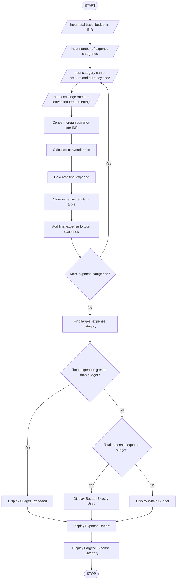

# 9. Multi-Currency Travel Budget Analysis – Python Program

This B.Tech 1st-year assignment includes the problem statement, algorithm, flowchart, Python source code, sample input, sample output, and normal Mermaid flowchart code without colors.

## 1. Problem Statement

Design a Python program to analyze travel expenses in different currencies by converting them into Indian Rupees (INR). The program should calculate conversion fees, find the total travel expenses, compare the expenses against the planned budget, and identify the largest expense category.

Rules used in this program:

- Each expense has a category name, expense amount, currency code, exchange rate, and conversion fee percentage.
- Foreign currency amounts are converted into INR using the supplied exchange rate.
- A conversion fee is calculated based on the converted amount.
- The final expense is calculated by adding the conversion fee to the converted amount.
- All final expenses are added to calculate the total travel expenses.
- The total expenses are compared with the given travel budget.
- The category with the highest final expense is identified as the largest expense category.

Example: If a hotel expense is 100 USD and the exchange rate is 85 INR, the converted amount is 8500 INR. If the conversion fee is 2%, the final expense is 8670 INR.

## 2. Algorithm

1. Start.
2. Input the total travel budget in INR.
3. Input the number of expense categories.
4. For each expense, enter the category name, expense amount, currency code, exchange rate, and conversion fee percentage.
5. Convert the foreign currency amount into INR using the exchange rate.
6. Calculate the conversion fee.
7. Calculate the final expense by adding the conversion fee.
8. Store the expense details using tuples in a list.
9. Add each final expense to calculate the total travel expenses.
10. Find the largest expense category by comparing the final expenses.
11. Compare the total travel expenses with the budget.
12. Display the expense details, total expenses, budget status, remaining or extra amount, and largest expense category.
13. Stop.

## 3. Flowchart

    4.Python Source Code (Activity.py)
# Multi-Currency Travel Budget Analysis

expenses = []

budget = float(input("Enter total travel budget in INR: "))

n = int(input("Enter number of expense categories: "))

total_expenses = 0

for i in range(n):
    print("\nExpense Category", i + 1)

    category = input("Enter expense category: ")
    amount = float(input("Enter expense amount: "))
    currency = input("Enter currency code (USD/EUR/GBP): ").upper()
    rate = float(input("Enter exchange rate to INR: "))
    fee_percent = float(input("Enter conversion fee percentage: "))

    # Convert foreign currency into INR
    converted_amount = amount * rate

    # Calculate conversion fee
    fee = converted_amount * fee_percent / 100

    # Calculate final expense
    final_amount = converted_amount + fee

    # Store details in a tuple
    expense = (category, currency, amount, final_amount)
    expenses.append(expense)

    total_expenses += final_amount

# Find the largest expense category
largest_expense = expenses[0]

for expense in expenses:
    if expense[3] > largest_expense[3]:
        largest_expense = expense

# Display travel budget report
print("\n--- TRAVEL BUDGET REPORT ---")

for category, currency, amount, final_amount in expenses:
    print(category, ":", round(final_amount, 2), "INR")

print("Total Travel Expenses:", round(total_expenses, 2), "INR")
print("Travel Budget:", round(budget, 2), "INR")

# Compare expenses with budget
if total_expenses > budget:
    print("Status: Budget Exceeded")
    print("Extra Amount:", round(total_expenses - budget, 2), "INR")

elif total_expenses < budget:
    print("Status: Within Budget")
    print("Remaining Amount:", round(budget - total_expenses, 2), "INR")

else:
    print("Status: Budget Exactly Used")

print("Largest Expense Category:", largest_expense[0])
print("Largest Expense Amount:", round(largest_expense[3], 2), "INR")

## 5. Sample Input

Enter total travel budget in INR: 50000
Enter number of expense categories: 3

Expense Category 1
Enter expense category: Hotel
Enter expense amount: 100
Enter currency code (USD/EUR/GBP): USD
Enter exchange rate to INR: 85
Enter conversion fee percentage: 2

Expense Category 2
Enter expense category: Food
Enter expense amount: 50
Enter currency code (USD/EUR/GBP): USD
Enter exchange rate to INR: 85
Enter conversion fee percentage: 2

Expense Category 3
Enter expense category: Shopping
Enter expense amount: 100
Enter currency code (USD/EUR/GBP): EUR
Enter exchange rate to INR: 95
Enter conversion fee percentage: 2

## 6. Sample Output

--- TRAVEL BUDGET REPORT ---

Hotel : 8670.0 INR
Food : 4335.0 INR
Shopping : 9690.0 INR

Total Travel Expenses: 22695.0 INR
Travel Budget: 50000.0 INR

Status: Within Budget
Remaining Amount: 27305.0 INR

Largest Expense Category: Shopping
Largest Expense Amount: 9690.0 INR

Explanation:

- Hotel: 100 × 85 = 8500 INR. Conversion fee = 170 INR. Final expense = 8670 INR.
- Food: 50 × 85 = 4250 INR. Conversion fee = 85 INR. Final expense = 4335 INR.
- Shopping: 100 × 95 = 9500 INR. Conversion fee = 190 INR. Final expense = 9690 INR.
- Total travel expenses = 8670 + 4335 + 9690 = 22695 INR.
- Travel budget = 50000 INR.
- Remaining amount = 50000 − 22695 = 27305 INR.
- Shopping is the largest expense category because it has the highest final expense of 9690 INR.

Therefore, the travel expenses are within the given budget.

Note: The program uses exchange rates supplied by the user. It does not fetch live currency exchange rates. The program assumes that at least one expense category is entered.
