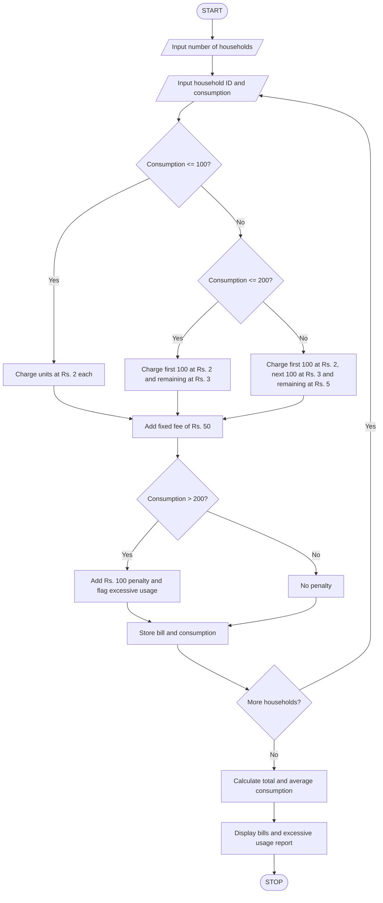

# 5. Progressive Water Tariff Analysis – Python Program

This B.Tech 1st-year assignment includes the problem statement, algorithm, flowchart, Python source code, sample input, sample output, and normal Mermaid flowchart code without colors.

## 1. Problem Statement

Design a Python program to calculate water bills for multiple households based on their monthly water consumption. The system should calculate charges using progressive consumption slabs, fixed fees, and penalties for excessive usage. It should compare household consumption patterns, identify households with unusually high water usage, and display each household's total bill.

Example rules used in this program:

| Monthly consumption      | Rate per unit |
| ------------------------ | ------------- |
| First 100 units          | ₹2 per unit   |
| Next 100 units (101–200) | ₹3 per unit   |
| Above 200 units          | ₹5 per unit   |

Additional rules:

- Fixed monthly fee: ₹50 per household.
- Excessive usage threshold: more than 200 units.
- Penalty: ₹100 for consumption above 200 units.
- Excessive usage is flagged when consumption exceeds 200 units.

These are example rules for the assignment, not official water tariff rates.

## 2. Algorithm

1. Start.
2. Input the number of households.
3. For each household, input its name or ID and monthly water consumption.
4. Calculate water charges using progressive consumption slabs.
5. Add the fixed monthly fee of ₹50.
6. If consumption exceeds 200 units, add a penalty of ₹100 and flag excessive usage.
7. Calculate the final bill for each household.
8. Store household consumption and bill details.
9. Compare consumption across households and calculate the average consumption.
10. Display each household's consumption, bill, penalty, and excessive-usage status.
11. Stop.

## 3. Flowchart



## 5. Sample Input

```
Enter number of households: 4

Household 1
Enter household name or ID: H101
Enter water consumption in units: 80

Household 2
Enter household name or ID: H102
Enter water consumption in units: 150

Household 3
Enter household name or ID: H103
Enter water consumption in units: 250

Household 4
Enter household name or ID: H104
Enter water consumption in units: 220
```

## 6. Sample Output

```
--- WATER BILL REPORT ---

Household: H101
Consumption: 80.0 units
Water charges: Rs. 160.0
Fixed fee: Rs. 50
Penalty: Rs. 0
Total bill: Rs. 210.0
Status: Normal usage

Household: H102
Consumption: 150.0 units
Water charges: Rs. 350.0
Fixed fee: Rs. 50
Penalty: Rs. 0
Total bill: Rs. 400.0
Status: Normal usage

Household: H103
Consumption: 250.0 units
Water charges: Rs. 950.0
Fixed fee: Rs. 50
Penalty: Rs. 100
Total bill: Rs. 1100.0
Status: Excessive usage

Household: H104
Consumption: 220.0 units
Water charges: Rs. 450.0
Fixed fee: Rs. 50
Penalty: Rs. 100
Total bill: Rs. 600.0
Status: Excessive usage

Total consumption: 700.0 units
Average consumption: 175.0 units

--- EXCESSIVE USAGE REPORT ---
H103 uses 250.0 units.
H104 uses 220.0 units.

Water tariff analysis completed.
```

Explanation: Households H103 and H104 exceed the 200-unit threshold, so each receives a ₹100 penalty. H103 has the highest consumption and the highest water bill.


Note: This program uses sample tariff rates and a fixed penalty. It compares household consumption against a fixed threshold of 200 units; it does not compare consumption with previous months.
