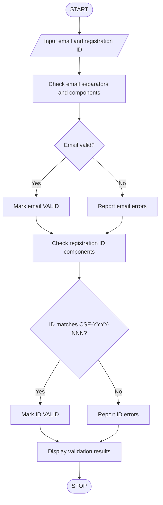

# Student Email and Identifier Validation

## 1. Problem Statement

Develop a Python program to validate student email addresses and registration identifiers according to specified formatting rules. The program must identify malformed separators, invalid characters, missing components, and incorrect formats, then display whether each input is valid or invalid.

## 2. Formatting Rules

Email format: `username@domain.extension`

- Must contain exactly one `@` symbol.
- Username may contain letters, digits, underscores, and dots.
- Username must not start or end with a dot or contain consecutive dots.
- Domain labels may contain letters, digits, and hyphens.
- Domain extension must contain at least two letters.

Registration ID format: `CSE-YYYY-NNN`

- `CSE` — department code.
- `YYYY` — four-digit admission year.
- `NNN` — three-digit student number.

## 3. Algorithm

1. Start.
2. Read the student's email and registration ID.
3. Check the email separator, username, domain, extension, and allowed characters.
4. Report any email errors.
5. Check the registration ID components and their formats.
6. Report any registration ID errors.
7. Display the validation results.
8. Stop.


## 5. Sample Input

```
Enter student email: kusuma..priya@gmail.com
Enter registration ID: CSE-26-01
```

## 6. Sample Output

```
--- VALIDATION RESULTS ---
Email: INVALID
- Consecutive dots in username

Registration ID: INVALID
- Year must contain exactly 4 digits
- Student number must contain exactly 3 digits

Validation completed.
```
## 7. Flow chart


## 8. Valid Test Case

Input:

```
Email: kusuma.priya@gmail.com
Registration ID: CSE-2026-001
```

Output:

```
Email: VALID
Registration ID: VALID
Validation completed.
```

Conclusion: The Python program checks student email and registration ID formatting, identifies errors, and displays validation results. It checks formatting only; it does not verify whether an email address or registration ID actually exists.
