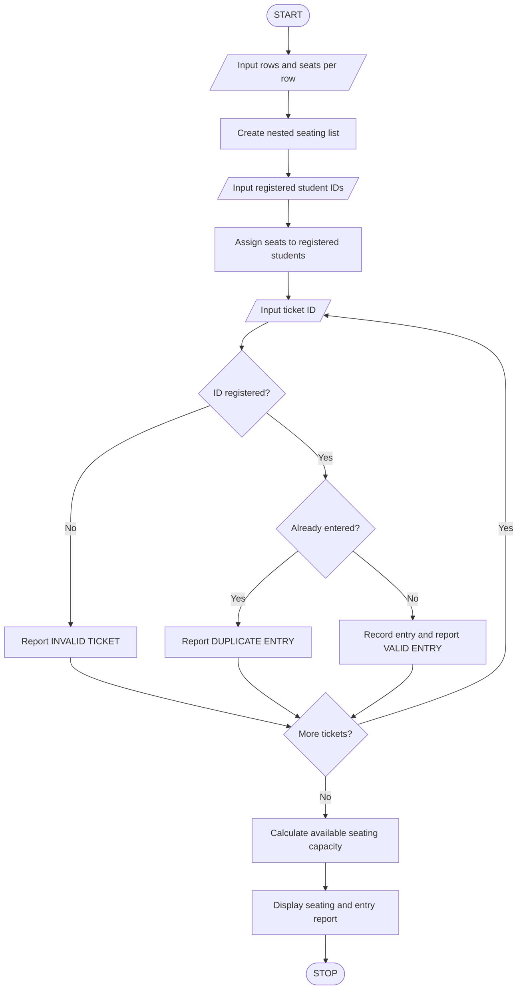

# Campus Event Seating and Entry Validation

## 1. Problem Statement

Develop a Python program to generate seating assignments using nested lists, validate event tickets against student registration identifiers, detect duplicate entries, and calculate the available seating capacity. The program should display seating details and clearly report invalid or duplicate tickets.

## 2. Rules and Assumptions

- The seating arrangement consists of rows and seats represented by a nested list.
- Each registered student has a unique registration ID, such as `CSE-2026-001`.
- A ticket is valid only if its registration ID is present in the registration list.
- If the same registration ID enters more than once, the later entry is marked as a duplicate.
- Available capacity means the number of seats not yet assigned to registered students.

## 3. Algorithm




## 5. Sample Input

```
Enter number of rows: 2
Enter seats per row: 3
Enter number of registered students: 4
Enter registration ID: CSE-2026-001
Enter registration ID: CSE-2026-002
Enter registration ID: CSE-2026-003
Enter registration ID: CSE-2026-004
Enter number of tickets presented: 5
Enter ticket registration ID: CSE-2026-001
Enter ticket registration ID: CSE-2026-002
Enter ticket registration ID: CSE-2026-001
Enter ticket registration ID: CSE-2026-999
Enter ticket registration ID: CSE-2026-004
```

## 6. Sample Output

```
--- SEATING ARRANGEMENT ---
Row 1 : ['CSE-2026-001', 'CSE-2026-002', 'CSE-2026-003']
Row 2 : ['CSE-2026-004', None, None]

--- ENTRY VALIDATION ---
CSE-2026-001 - VALID ENTRY
CSE-2026-002 - VALID ENTRY
CSE-2026-001 - DUPLICATE ENTRY
CSE-2026-999 - INVALID TICKET
CSE-2026-004 - VALID ENTRY

--- EVENT REPORT ---
Total seating capacity: 6
Registered students: 4
Seats assigned: 4
Available seats: 2
Unique valid entries: 3
Validation completed.
```


## 8. Conclusion

The program uses nested lists to allocate seats and a set to detect duplicate entries. It validates tickets against registered student IDs and reports total capacity, assigned seats, and available seats.

Important: This program models ticket validation for an academic assignment. It does not verify QR codes, payment status, or actual ticket authenticity.
