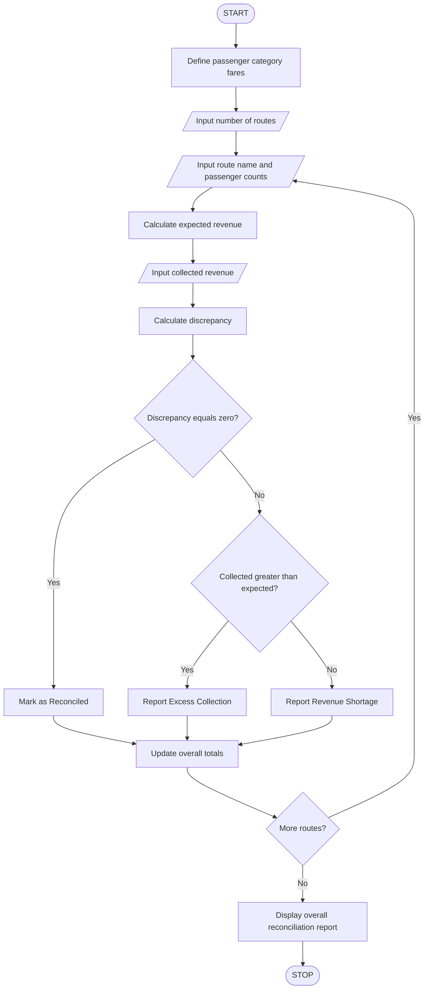

# 3. Smart Public Transport Fare Reconciliation

## 1. Problem Statement

Develop a Python program to calculate passenger fares across multiple public transport routes and passenger categories. The program should calculate expected revenue, record collected revenue, reconcile both amounts, and identify discrepancies between expected and collected fares.

## 2. Fare Policy

The following sample fare rules are used:

| Passenger category | Fare per trip |
| ------------------ | ------------- |
| Adult              | ₹30           |
| Student            | ₹15           |
| Senior Citizen     | ₹20           |
| Child              | ₹10           |

- Expected revenue = Number of passengers × Fare per trip.
- Total expected revenue = Sum of expected revenue across all routes and categories.
- Discrepancy = Collected revenue − Expected revenue.
- Positive discrepancy means excess collection.
- Negative discrepancy means a shortage.
- Zero discrepancy means the revenue is reconciled.

## 3. Algorithm




## 5. Sample Input

```
Enter number of routes: 2

Route 1
Enter route name: City Center
Enter number of Adult passengers: 10
Enter number of Student passengers: 5
Enter number of Senior Citizen passengers: 2
Enter number of Child passengers: 3
Enter collected revenue: 480

Route 2
Enter route name: Railway Station
Enter number of Adult passengers: 8
Enter number of Student passengers: 4
Enter number of Senior Citizen passengers: 1
Enter number of Child passengers: 2
Enter collected revenue: 350
```

## 6. Sample Output

```
--- FARE RECONCILIATION REPORT ---

Route: City Center
Expected revenue: Rs. 475
Collected revenue: Rs. 480
Discrepancy: Rs. 5
Status: Excess collection

Route: Railway Station
Expected revenue: Rs. 330
Collected revenue: Rs. 350
Discrepancy: Rs. 20
Status: Excess collection

--- OVERALL SUMMARY ---
Total expected revenue: Rs. 805
Total collected revenue: Rs. 830
Overall discrepancy: Rs. 25
Overall status: Excess collection

Reconciliation completed.
```


## 8. Conclusion

The program calculates passenger fares across multiple routes and categories, compares expected revenue with actual collections, and identifies excess collections, shortages, and reconciled routes.

Note: The fare values are sample values for this assignment. Actual fares should be updated according to the transport authority's rules.
